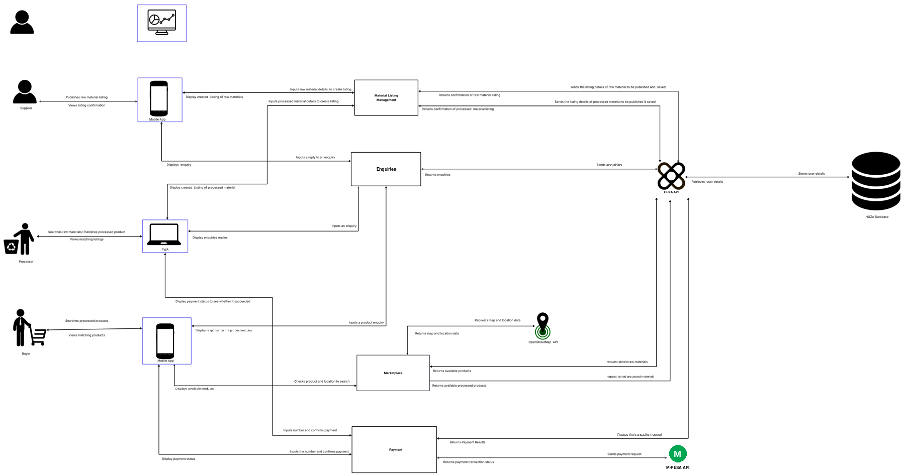
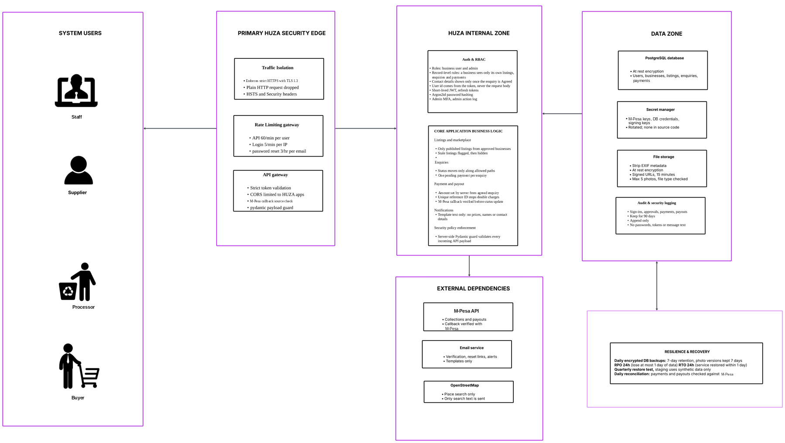
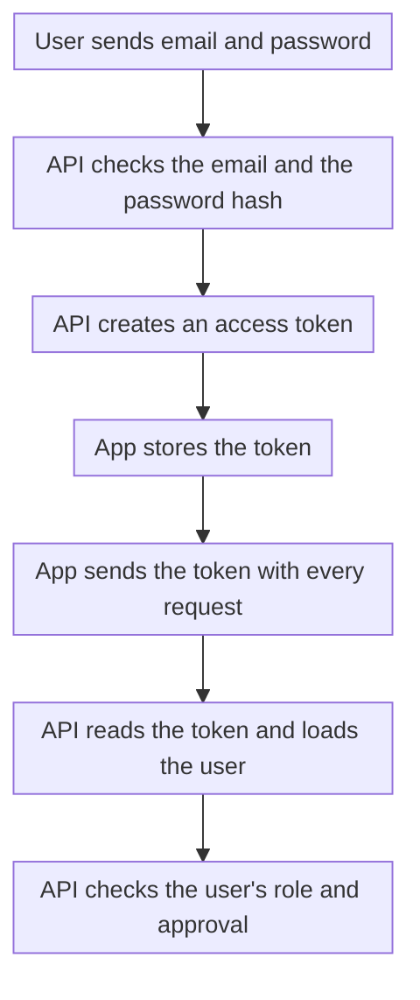
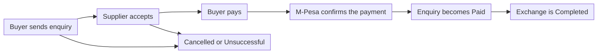

# System Architecture

## Purpose of the Architecture

HUZA connects businesses that have leftover industrial materials with businesses that can use them. The architecture shows how a listing, an enquiry and a payment move through the system and who is allowed to do what at each step.

The main idea is one clear record for every exchange. A listing leads to an enquiry, an enquiry leads to an agreement and an agreement leads to a payment. Nothing sits in separate places that cannot be connected.

## System Architecture Diagram

The SAD is a high-level picture of how the parts of HUZA fit together. It shows the people who use the system, the apps they use, the backend, the database and the services outside HUZA.

- **Primary goal:** to show how data moves through HUZA and which part is responsible for each step.




## Secure SSAD

The SSAD adds the security view on top of the same system. It shows where users are checked, where data is kept and where the safety boundaries sit.

- **Core focus:** who can do what, keeping business data safe and keeping every payment traceable.



The details are on [Backend security](backend/security.md).

### Security controls in the backend

- **Roles:** every request is checked against the person's role and a business sees only its own data.
- **Approval:** a business cannot trade until staff approve it.
- **Sign-in:** passwords are stored as Argon2 hashes, tokens expire and an account is locked after repeated wrong passwords.
- **Payments:** every payment is tied to one enquiry and M-Pesa reports back through a signed address.
- **Photos:** each upload is checked and saved again as a smaller image.

## Components & Responsibilities

| Component | Primary responsibility |
| --- | --- |
| Mobile app | Lets suppliers and buyers list materials and send enquiries. |
| Web app (PWA) | Lets processors find materials and manage their enquiries. |
| Admin dashboard | Lets staff approve businesses and watch listings, enquiries and metrics. |
| HUZA API | Receives every request, checks who is asking, applies the rules and returns a response. |
| Sign in and accounts | Registers users, signs them in and tells the API who they are and what role they have. |
| Business approval | Keeps every new business on hold until staff approve it. |
| Listings | Stores each material offer with its stream, quantity, price and place. |
| Enquiries | Tracks an exchange from first question to completion or failure. |
| Payments | Records each payment and links it to its enquiry. |
| Price guides | Gives suppliers a guide price for each material. |
| Notifications | Tells users when something changes on their listing or enquiry. |
| Database | Stores every record and the links between them. |
| M-Pesa | Moves the money when a buyer pays. |

## Data Flow

These are the steps of a full exchange:

- **Registration:** a business signs up and chooses its role, which is supplier, processor or buyer.
- **Approval:** the business waits as Pending until staff approve it. Staff can also reject or suspend a business.
- **Listing:** an approved supplier lists a material with a quantity, a price and a place.
- **Enquiry:** a buyer or processor finds the listing and sends an enquiry. The enquiry starts with the status Enquiry.
- **Agreement:** the supplier accepts and the status becomes Agreed. Collection is arranged between the two businesses, outside the app.
- **Payment:** the buyer pays in the app. When the payment is confirmed, the status becomes Paid.
- **Completion:** the exchange is marked Completed.
- **Failure:** if the exchange stops, it becomes Cancelled or Unsuccessful and a reason is recorded.
- **Monitoring:** staff watch all of this through the admin dashboard and its metrics.

## Architecture Layers

HUZA is organised into layers. Each layer has one job, so a change in one place does not force changes everywhere.

### 1. Presentation layer

The apps people use to record, review and manage information.

#### 1.1 Mobile app

Suppliers and buyers use the mobile app to:

- Register and sign in.
- List a material.
- Send and answer enquiries.
- Pay for an agreed exchange.

**Example:** a carpenter lists a bag of sawdust with a price and a pickup place. A farm nearby sees it and sends an enquiry.

The apps never write to the database directly. The HUZA API keeps the rules and the access checks in one place.

#### 1.2 Web app (PWA)

Processors use the web app to find materials in bulk and to manage their listings and enquiries from a computer or a phone browser.

#### 1.3 Admin dashboard

Staff use the admin dashboard to:

- Approve, reject or suspend businesses.
- View all listings and enquiries.
- Watch marketplace metrics with date filters.

**Example:** a new supplier signs up. Staff open the approvals page, check the business and approve it. Only then can the supplier list materials.

### 2. Application layer

The HUZA API is a FastAPI server. Every request goes through the same steps: check the token, check the data, check the role, run the action and send back a response.

| Part | What it does |
| --- | --- |
| Routes | Receive requests and send responses. |
| Schemas | Check that incoming data has the right shape and shape the data that goes out. |
| Role checks | Allow or refuse an action depending on the user's role. |
| Services | Hold the business rules, such as which status can follow which. |
| Database access | Reads and writes records through SQLAlchemy. |

### 3. Data layer

#### 3.1 What is stored

HUZA keeps its records in a PostgreSQL database. Database changes are managed with Alembic migrations, so every environment gets the same structure.

| Record | What it stores | Example |
| --- | --- | --- |
| User | A person's account and role | A supplier's login |
| Business | A business and its approval status | A sawmill, status Pending |
| Location | A place where materials are found | A town or area |
| Listing | A material offer | 200 kg of sawdust at a set price |
| Enquiry | An exchange and its status | A buyer asking about that sawdust |
| Payment | A payment linked to an enquiry | The buyer's M-Pesa payment |

#### 3.2 Why relationships matter

A payment points to the enquiry it paid for. The enquiry points to the listing. The listing points to the business that owns it. This gives a connected history for every exchange, so staff can see not only where an exchange is now, but how it got there.

### 4. Integration layer

#### 4.1 M-Pesa

When a buyer pays, HUZA asks M-Pesa to take the payment. M-Pesa reports back and HUZA then updates the payment and the enquiry.

#### 4.2 Hosting

The backend runs on Heroku with a PostgreSQL database. The apps reach it through one API address that is set when each app is built.

## Authentication Flow



A request fails with `401` when the token is missing, wrong or expired. A request fails with `403` when the token is valid but the role is not allowed to do that action.

Staff accounts are different from supplier and buyer accounts. A staff sign-up needs an invite code that only HUZA holds, so nobody can make themselves staff.

## Request and Response Flow

A normal request follows these steps:

1. The user does something in the app.
2. The app checks the obvious things, such as empty fields.
3. The app sends the request to the HUZA API with the token.
4. The API reads and checks the token.
5. The API checks the data in the request.
6. The API checks that the user's role allows this action.
7. The service applies the business rules.
8. The service reads or writes the database.
9. The API sends back the result in a fixed shape.
10. The app updates what the user sees.

### Request

Example: a supplier lists a material.

```json
{
  "stream": "SAWDUST",
  "quantity": 200,
  "unit": "kg",
  "price": 3000,
  "location_id": 2
}
```

### Response

```json
{
  "id": 12,
  "stream": "SAWDUST",
  "quantity": 200,
  "unit": "kg",
  "price": 3000,
  "status": "ACTIVE"
}
```

The field names above show the shape of a request. The exact names are in the API reference.

## Exchange Flow



When an exchange fails, HUZA records one reason: no partner found, quality, price, transport, quantity, trust, payment, declined or other. These reasons feed the admin metrics, so staff can see why exchanges fail and what to improve.
