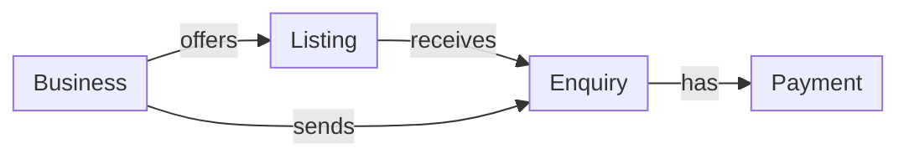

# Data model

## 1. Overview

HUZA keeps all its records in a PostgreSQL database. The tables are described in the backend code as SQLAlchemy models, and every change to them is saved as an Alembic migration, so each computer and server ends up with the same structure.

## 2. Tables

| Table | What it holds |
| --- | --- |
| users | Everyone who can sign in, including staff |
| businesses | A supplier, processor or buyer, with its approval status |
| locations | A place picked from OpenStreetMap |
| listings | Material that a supplier offers |
| enquiries | A buyer's request on a listing, and where it stands |
| payments | The buyer's payment and the supplier's payout |
| price_guides | Normal price ranges by material, grade and district |
| notifications | In-app alerts |

## 3. Relationships



- A supplier business offers many listings.
- A listing can receive many enquiries.
- A buyer business can send many enquiries.
- An enquiry can have payments, and only one of them can be successful.

This gives every exchange a connected history. A payment points to its enquiry, the enquiry points to its listing, and the listing points to the business that owns it.

## 4. Rules the database enforces

The database refuses data that breaks these rules, even if an app or the API makes a mistake.

| Rule | Why it matters |
| --- | --- |
| A buyer can have only one open enquiry per listing | Stops duplicate enquiries on the same material |
| A cancelled or unsuccessful enquiry must have a failure reason, and no other enquiry may have one | Keeps the failure numbers on the dashboard honest |
| An enquiry can have only one successful payment | Stops a buyer from paying twice for one exchange |
| On a payment, the payout amount plus the fee equals the amount paid | Keeps the money adding up |
| Only suppliers have a supplier kind | Producer, collector and dealer apply to suppliers only |
| A payout phone number always comes with its network | A payout cannot be sent without knowing where |

## 5. Allowed values

| Item | Values |
| --- | --- |
| Roles | Supplier, processor, buyer, staff |
| Supplier kind | Producer, collector, dealer |
| Material streams | Sawdust, plastic, garment offcuts, glass |
| Business approval | Pending, approved, rejected, suspended |
| Listing status | Draft, published, paused |
| Enquiry status | Enquiry, agreed, paid, completed, cancelled, unsuccessful |
| Failure reason | Price, quality, transport, quantity, no partner found, payment |
| Payout status | Pending, paid |

## 6. Migrations

Every change to the tables is a migration. After you pull new code, run:

```bash
alembic upgrade head
```

If a page fails with "column does not exist", your database is behind, and this command fixes it. To start with an empty database, create it and run the same command. It builds every table in order.

Rules the team follows:

- Never change a table by hand. Write a migration instead.
- Never edit a migration that has already been shared. Add a new one.
- Run `alembic upgrade head` on the hosted database whenever new code that changes tables is deployed.

## 7. Where to go next

- [API reference](api-reference.md) for the endpoints that read and write these tables.
- [Payments](payments.md) for how payments and payouts work.