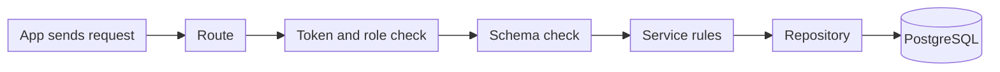

# Backend overview

## 1. Overview

The backend is the HUZA API. Every app talks to it: the mobile app, the web app and the admin dashboard. It checks who is asking, applies the marketplace rules and stores everything in PostgreSQL.

It is built with these tools:

| Tool | Used for |
| --- | --- |
| FastAPI | The API and the live documentation page |
| SQLAlchemy | Talking to the database |
| Alembic | Database migrations |
| PostgreSQL | The database |
| Pydantic settings | Reading settings from the environment |
| uv | Installing packages |
| pytest and ruff | Tests, formatting and style checks |

The live API is at [huza-2fb08e00b606.herokuapp.com/docs](https://huza-2fb08e00b606.herokuapp.com/docs). Open it to try any endpoint.

## 2. Backend architecture

### One request through the API

1. The route receives the request.
2. The API reads the token and finds the user.
3. A role check allows or refuses the action.
4. The schema checks that the data has the right shape.
5. The service applies the marketplace rules, such as which enquiry status may come next.
6. The repository reads or writes the database.
7. The API sends back an answer in a fixed shape.

Each step has one job. This keeps the rules in one place, so the apps never need to repeat them.

### Folder layout

| Folder | What is inside |
| --- | --- |
| `routers/` | The endpoints, grouped by feature |
| `schemas/` | The shapes of requests and answers |
| `services/` | The marketplace rules |
| `repositories/` | The database queries |
| `models/` | The database tables |
| `migrations/` | The Alembic history of the database |
| `core/` | Settings and shared tools |
| `tests/` | The automated tests |

`main.py` and `database.py` sit at the root of the project. `dependencies.py` is in `core/`.

## 3. Configuration

The backend reads its settings from a `.env` file on your computer and from server settings when it is hosted. Secrets are never kept in git.

| Setting | What it is |
| --- | --- |
| `DATABASE_URL` | The address of the PostgreSQL database |
| `JWT_SECRET` | A long random secret used to sign sign-in tokens |
| `ADMIN_INVITE_CODE` | At least 16 characters. Staff need it to create an account |
| `ENVIRONMENT` | development, test or production |
| `MPESA_` settings | The payment values. See [Payments](payments.md) |
| `BREVO_API_KEY` and `EMAIL_FROM` | Send the verification and reset emails |

## 4. Pages in this section

- :material-database-outline: **Data model**

    ---

    The tables, the rules the database enforces and the main statuses.

    [:octicons-arrow-right-24: Open the data model](data-model.md)

- :material-api: **API reference**

    ---

    Every endpoint, who may call it and what it does.

    [:octicons-arrow-right-24: Open the API reference](api-reference.md)

- :material-cash-multiple: **Payments**

    ---

    How a buyer pays and how the supplier is paid out.

    [:octicons-arrow-right-24: Open payments](payments.md)

- :material-chart-line: **Admin metrics**

    ---

    The numbers staff see on the dashboard.

    [:octicons-arrow-right-24: Open admin metrics](admin-metrics.md)

- :material-check-circle-outline: **Testing**

    ---

    How the backend is tested and how to run the tests.

    [:octicons-arrow-right-24: Open testing](testing.md)

