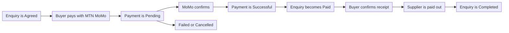

# Payments

## 1. Overview

A buyer pays for an agreed exchange inside the app, using MTN Mobile Money (MTN MoMo). HUZA records the payment, links it to the enquiry, and later pays the supplier out to their own MoMo number.

Every payment belongs to one enquiry. This keeps the money and the exchange together, so staff can always see what a payment was for.

## 2. How a payment moves

1. The supplier accepts an enquiry, and it becomes Agreed.
2. The buyer starts a payment with their MTN MoMo number.
3. The payment is saved as Pending while MoMo processes it.
4. When MoMo confirms, the payment becomes Successful and the enquiry becomes Paid.
5. The buyer collects the material and confirms receipt in the app.
6. The supplier is paid out to their payout number.
7. The exchange is marked Completed.

If the payment does not go through, it becomes Failed. If it is stopped before it finishes, it becomes Cancelled.

## 3. What is stored for a payment

| Field | What it holds |
| --- | --- |
| Amount | How much the buyer pays. It must be more than zero |
| Payer phone | The MTN MoMo number that pays |
| Reference | A unique reference that HUZA creates for the payment |
| MoMo transaction ID | The ID that MTN MoMo gives back |
| Status | Pending, successful, failed or cancelled |
| Failure reason | Why a payment failed |
| Payout status | Not due, pending, paid or failed |
| Payout reference | The reference of the payout to the supplier |
| Paid at | When the buyer's payment succeeded |
| Paid out at | When the supplier was paid |

## 4. Rules the database enforces

- An enquiry can have only one pending payment at a time.
- An enquiry can have only one successful payment, so a buyer cannot pay twice.
- The reference of every payment is unique.
- On a payment, the payout amount plus the fee equals the amount paid.
- A payout phone number always comes with its network.

## 5. Payout details

A supplier must save payout details before they can be paid.

| Method | Path | What it does |
| --- | --- | --- |
| GET | `/payments/payout-details` | See my payout details |
| PUT | `/payments/payout-details` | Set my payout details |

The payout network is MTN MoMo.

## 6. Endpoints

| Method | Path | What it does |
| --- | --- | --- |
| POST | `/enquiries/{enquiry_id}/payments` | Buyer pays |
| GET | `/enquiries/{enquiry_id}/payments` | Payments on an enquiry |
| POST | `/enquiries/{enquiry_id}/confirm-receipt` | Buyer confirms receipt |
| GET | `/payments` | My payments |
| GET | `/payments/{payment_id}` | One payment |

## 7. What staff can do

Staff handle problems from the admin side.

| Method | Path | What it does |
| --- | --- | --- |
| GET | `/admin/payments` | List all payments |
| POST | `/admin/payments/{payment_id}/reconcile` | Match a payment with MTN MoMo |
| POST | `/admin/payments/{payment_id}/refund` | Refund a payment |
| POST | `/admin/payments/{payment_id}/payout` | Send the payout to the supplier |

Use reconcile when the app and MoMo disagree, for example when the buyer was charged but the payment still shows Pending.