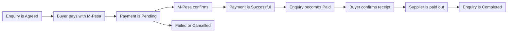

# Payments

## 1. Overview

A buyer pays for an agreed exchange inside the app, using M-Pesa. HUZA sends a payment request to the buyer's phone, records the payment, links it to the enquiry and later pays the supplier out to their own M-Pesa number.

Every payment belongs to one enquiry. This keeps the money and the exchange together, so staff can always see what a payment was for.

## 2. How a payment moves

1. The supplier accepts an enquiry and it becomes Agreed.
2. The buyer starts a payment with their M-Pesa phone number and a payment request appears on their phone.
3. The payment is saved as Pending while M-Pesa processes it.
4. When M-Pesa confirms, the payment becomes Successful and the enquiry becomes Paid.
5. The buyer collects the material and confirms receipt in the app.
6. The supplier is paid out to their payout number.
7. The exchange is marked Completed.

If the payment does not go through, it becomes Failed. If it is stopped before it finishes, it becomes Cancelled.

## 3. What is stored for a payment

| Field | What it holds |
| --- | --- |
| Amount | How much the buyer pays. It must be more than zero |
| Payer phone | The M-Pesa number that pays |
| Reference | A unique reference that HUZA creates for the payment |
| M-Pesa transaction ID | The ID that M-Pesa gives back |
| Status | Pending, successful, failed or cancelled |
| Failure reason | Why a payment failed |
| Payout status | Not due, pending, paid or failed |
| Payout reference | The reference of the payout to the supplier |
| Refund status | None, pending, refunded or failed |
| Paid at | When the buyer's payment succeeded |
| Paid out at | When the supplier was paid |

Every step of a payment is also saved as an event, so staff can see how a payment got to its current status.

## 4. Rules the database enforces

- An enquiry can have only one pending payment at a time.
- An enquiry can have only one successful payment, so a buyer cannot pay twice.
- The reference of every payment is unique.
- On a payment, the payout amount plus the fee equals the amount paid.
- A payout phone number always comes with its network.

## 5. Payment settings

The backend reads these settings from the environment. Each one starts with MPESA_.

| Setting | What it controls |
| --- | --- |
| `MPESA_ENVIRONMENT` | sandbox or production |
| `MPESA_MODE` | live, or simulated for trying the flow without real money |
| `MPESA_CONSUMER_KEY` and `MPESA_CONSUMER_SECRET` | The keys that Safaricom gives the app |
| `MPESA_EXPRESS_SHORTCODE` and `MPESA_EXPRESS_PASSKEY` | The shortcode and passkey that take the buyer's payment |
| `MPESA_B2C_SHORTCODE`, `MPESA_INITIATOR_NAME` and `MPESA_SECURITY_CREDENTIAL` | What sends the payout to the supplier |
| `MPESA_CALLBACK_BASE_URL` and `MPESA_CALLBACK_SECRET` | Where M-Pesa reports back and the secret that signs that address |
| `MPESA_MAX_ATTEMPTS_PER_ENQUIRY` | How many payment tries one enquiry gets. The default is 5 |
| `MPESA_ATTEMPT_COOLDOWN_SECONDS` | The wait between two tries. The default is 30 |
| `MPESA_AUTO_PAYOUT` | Whether the payout is sent automatically. The default is on |
| `MPESA_HUZA_FEE_PERCENT` | The HUZA fee. The default is 0 |

The values themselves are secrets. They live only in the environment, never in the code.

## 6. Payout details

A supplier must save payout details before they can be paid.

| Method | Path | What it does |
| --- | --- | --- |
| GET | `/payments/payout-details` | See my payout details |
| PUT | `/payments/payout-details` | Set my payout details |

The payout network is M-Pesa.

## 7. Endpoints

| Method | Path | What it does |
| --- | --- | --- |
| POST | `/enquiries/{enquiry_id}/payments` | Buyer pays |
| GET | `/enquiries/{enquiry_id}/payments` | Payments on an enquiry |
| POST | `/enquiries/{enquiry_id}/confirm-receipt` | Buyer confirms receipt |
| GET | `/payments` | My payments |
| GET | `/payments/{payment_id}` | One payment |

M-Pesa reports back to the API on its own address. Apps never call it.

## 8. What staff can do

Staff handle problems from the admin side.

| Method | Path | What it does |
| --- | --- | --- |
| GET | `/admin/payments` | List all payments |
| POST | `/admin/payments/{payment_id}/reconcile` | Match a payment with M-Pesa |
| POST | `/admin/payments/sweep` | Match every pending payment with M-Pesa |
| GET | `/admin/payments/{payment_id}/events` | See the steps a payment went through |
| POST | `/admin/payments/{payment_id}/refund` | Refund a payment |
| POST | `/admin/payments/{payment_id}/payout` | Send the payout to the supplier |

Use reconcile when the app and M-Pesa disagree, for example when the buyer was charged but the payment still shows Pending.
