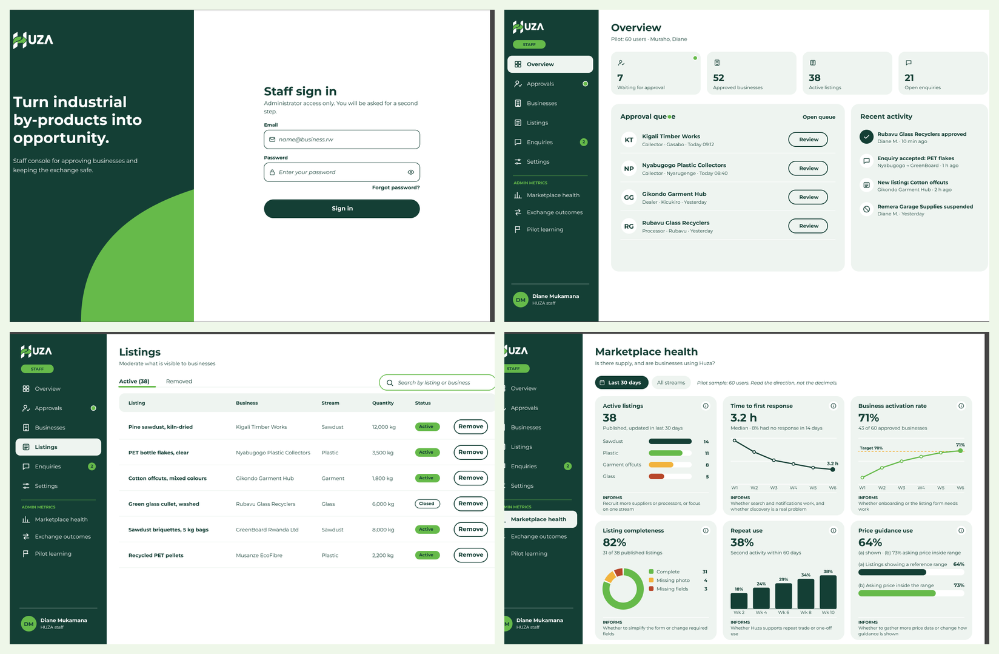
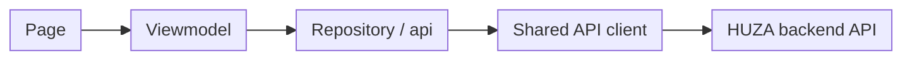

# Admin dashboard

The admin dashboard is the web app HUZA staff use to run the marketplace. Businesses never see it. Staff use it to approve new businesses, watch listings and enquiries, set price ranges and follow the admin metrics.

| Item | Details |
|---|---|
| Repository | `athena-dashboard` |
| Stack | React, Vite, TypeScript, Tailwind CSS 4 |
| Dev port | 3001 |
| Talks to | The HUZA backend API (FastAPI) |
| Users | HUZA staff only (admin role) |

## Preview



## What staff can do

| Page | What it is for |
|---|---|
| Overview | Counts of what needs attention, with links to each page |
| Approvals | Review new businesses and approve or reject them with a reason |
| Businesses | See every business and suspend or restore one |
| Listings | See what is visible to businesses and remove a listing |
| Price guides | Add, edit or delete normal price ranges |
| Enquiries | Follow every enquiry and its status |
| Settings | Staff accounts and marketplace rules |
| Marketplace health | Admin metrics: how active the marketplace is |
| Exchange outcomes | Admin metrics: how enquiries end |
| Pilot learning | Admin metrics: what the pilot teaches us |

### Approvals and the tabs

The approvals list has three tabs: Pending, Approved and Rejected. The chosen tab is saved in the page address, for example `/approvals?tab=APPROVED`. Clicking a row opens the business and the back arrow returns to the same tab.

## Sign in and sign up

### Sign in

Staff sign in with their email and password. The sign-in page also has a **Create account** link for new staff and a link to reset a forgotten password. If the email or password is wrong, the page says so without saying which one.

### Create a staff account

Only people with an invite code can create a staff account. A current administrator gives the code.

| Field | Notes |
|---|---|
| Full name | Required |
| Work email | Required and must not be used already |
| Phone number | Starts with +254 |
| Password | At least 8 characters with a number |
| Confirm password | Must match |
| Invite code | The secret code from an administrator |

After the account is created, the dashboard signs the person in and opens the overview.

### What the messages mean

| What staff see | What happened |
|---|---|
| Staff sign-up is not open right now | The backend has no invite code set, or does not have staff sign-up yet |
| The invite code is not right | The code does not match |
| An account with this email already exists | The email is taken |
| Email or password is wrong | Sign-in failed |

### Behind the scenes

The form sends `POST /auth/register-admin` with the full name, email, phone number, password and invite code. After the account is created, the dashboard calls `POST /auth/login` to sign the person in.

| Answer | Cause |
|---|---|
| 201 | Account created |
| 403 | Wrong invite code |
| 404 | No invite code is set on the server |
| 409 | Email already used |
| 422 | A field is missing or in the wrong shape |

The backend reads the code from the `ADMIN_INVITE_CODE` setting. It must be at least 16 characters and it is a secret. See [Backend security](../backend/security.md) and [Backend deployment](../backend/deployment.md).

## Local setup

Requirements: Node.js (current LTS) and npm. The backend should be running if you want real data.

```bash
git clone <athena-dashboard repository URL>
cd athena-dashboard
npm ci
cp .env.example .env
npm run dev
```

Open http://localhost:3001.

Set `VITE_API_URL` in `.env` to the backend address. Do not commit `.env`.

### Scripts

| Command | What it does |
|---|---|
| `npm run dev` | Start the dev server on port 3001 |
| `npm run build` | Type check and build to `dist/` |
| `npm run lint` | Run oxlint |
| `npm run format` | Format with Prettier |
| `npm test` | Run the Vitest tests once |

## How the app works

1. The app starts, reads `VITE_API_URL` and sets up React Router.
2. Staff sign in. The token is kept and a shared API client adds it to every request.
3. If the token has expired, the dashboard signs the person out and asks them to sign in again.
4. Each page loads only when opened, which keeps the first load fast.
5. A page reads its data through a viewmodel and the viewmodel uses a repository to call the API.



## Repository structure

Each feature has its own folder under `src/features/`, such as `approvals`, `listings` or `enquiries`. A small feature keeps its page and a repository file together. A larger feature, such as `approvals`, splits into these parts:

| Part | What it does |
|---|---|
| `pages/` | The screen |
| `components/` | Pieces used only by that feature |
| `viewmodels/` | The logic behind the screen, such as loading and filtering |
| `api/` | Talks to the backend |
| `__tests__/` | The tests |

Shared pieces live in `src/components/` and `src/lib/`.

## Dependencies

| Package | Why we use it |
|---|---|
| React and TypeScript | The screens |
| Vite | Running and building the app |
| Tailwind CSS 4 | Styling |
| React Router | Moving between pages |
| React Hook Form | Forms |
| Recharts | The charts on the metrics pages |
| Radix UI Dialog | Dialogs |
| Vitest and Testing Library | Tests |
| Prettier and oxlint | Formatting and style |

## Coding standards

- One folder per feature under `src/features/`.
- Pages show the screen only. Logic goes in the viewmodel.
- Only repositories and the `api` folder call the backend.
- Reuse shared components before making new ones.
- Style with Tailwind and the HUZA colours.
- Write tests for each page and repository.
- Run lint and format before every commit.

## How to add or change a feature

1. Create `src/features/<feature>/` with the page, a repository file and a `__tests__` folder.
2. Write the repository functions and types.
3. Keep loading, data, empty and error states in the page or a viewmodel.
4. Build the page and add its route in `src/routes.tsx` and its menu link.
5. Write tests for the viewmodel and the page.
6. Run lint, format check, tests and build.
7. Open a pull request using the team rules.

## Security

- Only staff with the admin role can use the dashboard. The backend checks this on every request.
- The token is handled only in the shared API client. Do not read or write it anywhere else.
- `VITE_API_URL` is baked in at build time and is public. Never put secrets in `VITE_` variables.
- The invite code is a secret. Share it only with people who should become staff.
- Do not log tokens or personal data.

## Testing

Tests use Vitest and Testing Library. Each feature has its own `__tests__` folder.

```bash
npm test
```

### What the tests cover

- Loading, data, empty and error states of each page
- Forms: required fields and error messages
- Approvals: tab changes, approve and reject with a reason
- Sign in and sign up: wrong password, wrong invite code, email already used

### If the tests stall

Stop the run, delete `node_modules`, run `npm ci` and try again. Check that no test is waiting on a network call.

## Deployment

```bash
npm run build
```

This writes a static site to `dist/`. Host it on any static host over HTTPS. `VITE_API_URL` must be set when you build. See [Backend deployment](../backend/deployment.md).

## Troubleshooting

| Problem | Fix |
|---|---|
| Blank page or network errors | Check `VITE_API_URL` and that the backend is running |
| Signed out suddenly | The token expired. Sign in again |
| Staff sign-up is not open | The backend has no `ADMIN_INVITE_CODE` |
| Changed `.env` but nothing changed | Restart the dev server. `VITE_` values are read at start and at build |

## Definition of done

- [ ] Works on a laptop and a tablet-sized screen
- [ ] Loading, empty and error states handled
- [ ] Tests written and passing
- [ ] Lint, format check and build pass
- [ ] No secrets or tokens in code or logs
- [ ] Pull request reviewed and approved

## Summary

The admin dashboard is a React and Vite app organised by feature. It signs staff in with an invite-code sign-up, reads data through viewmodels and repositories and gives staff one place to approve businesses and watch the marketplace.
