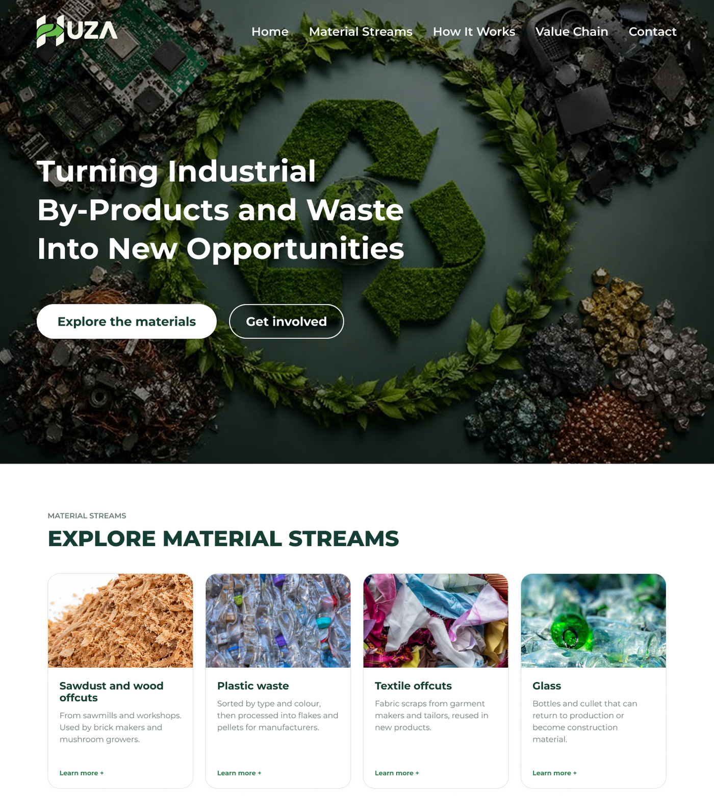
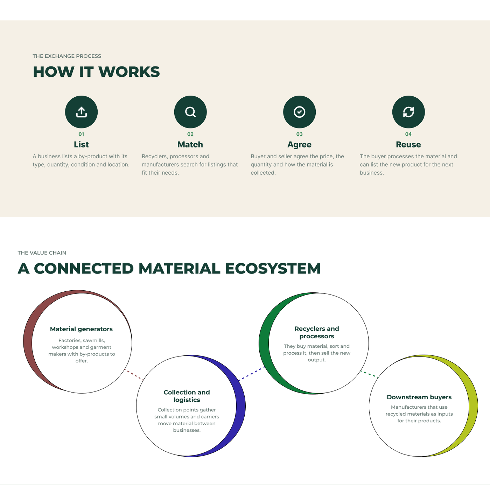
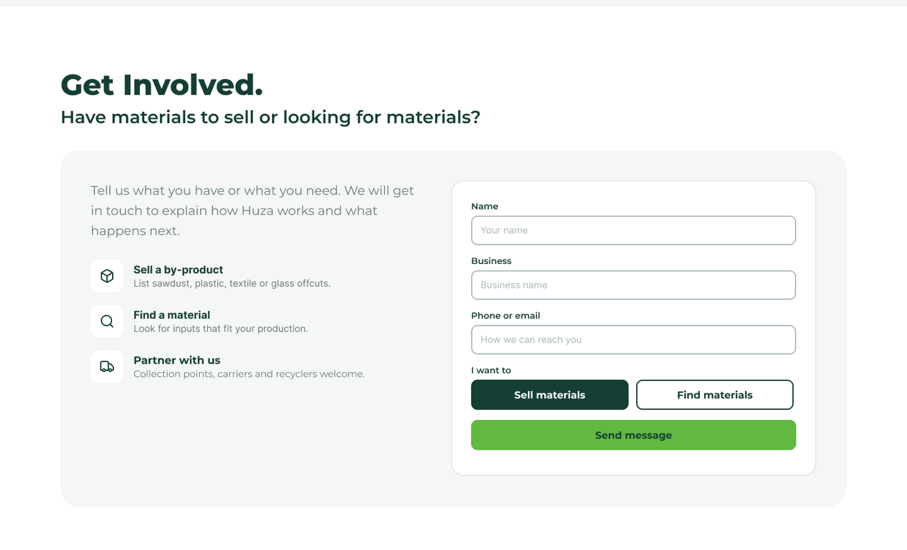

# Informational website

The informational website is the public face of HUZA. It tells visitors what HUZA is, why it matters, and how to get in touch.

The live website is at [athena-informational-website.vercel.app](https://athena-informational-website.vercel.app/){ target=_blank }.

| Item | Details |
|---|---|
| Repository | `athena-informational-website` |
| Stack | Next.js 16, React 19, TypeScript, Tailwind CSS 4 |
| Talks to | Nothing yet. It is a static, public site |

## Preview

**Home and material streams**



**How it works and the value chain**



**Get involved**



## Pages and sections

| Section | What visitors see |
|---|---|
| Home | Banner with the buttons Explore the materials and Get involved |
| Material streams | Cards for sawdust and wood offcuts, plastic waste, textile offcuts and glass |
| How it works | Four steps: List, Match, Agree, Reuse |
| Value chain | Material generators, collection and logistics, recyclers and processors, downstream buyers |
| Why it matters | Less waste, new income, local supply |
| Contact | Form to sell or find materials, and the footer with contact details |

## Local setup

Requirements: Node.js (current LTS) and npm.

```bash
git clone <athena-informational-website repository URL>
cd athena-informational-website
npm install
npm run dev
```

Open http://localhost:3000.

The site has no `.env` file and needs no environment variables today.

### Scripts

| Command | What it does |
|---|---|
| `npm run dev` | Start the dev server |
| `npm run build` | Build the site for production |
| `npm run start` | Run the production build |
| `npm run lint` | Check the code with ESLint |
| `npm run format` | Format all files with Prettier |

## How the site works

1. The site uses the Next.js App Router. Each folder in `app/` with a `page.tsx` is a page.
2. `app/layout.tsx` wraps every page with the shared layout and styles.
3. Pages are built from small shared components in `components/`.
4. Styling is done with Tailwind CSS. Global styles are in `app/globals.css`.
5. Icons come from lucide-react.

## Repository structure

| Path | Purpose |
|---|---|
| `app/layout.tsx` | Layout shared by all pages |
| `app/page.tsx` | Home page |
| `app/why-preview/page.tsx` | Preview of the "Why it matters" page |
| `app/globals.css` | Global styles |
| `app/favicon.ico` | Site icon |
| `components/PageHero.tsx` | Top banner of a page |
| `components/Section.tsx` | A page section with a heading |
| `components/WhyItMatters.tsx` | The "Why it matters" content |
| `components/ContactForm.tsx` | Contact form |
| `components/Button.tsx` | Shared button |
| `components/Footer.tsx` | Site footer |
| `lib/` | Small shared helpers |
| `public/` | Images and other static files |
| `next.config.ts` | Next.js settings |
| `eslint.config.mjs` | Lint rules |
| `AGENTS.md` | Notes for coding assistants working in the repo |

## Dependencies

| Package | Why we use it |
|---|---|
| Next.js | Framework, pages and build |
| React | UI |
| TypeScript | Type safety |
| Tailwind CSS | Styling |
| lucide-react | Icons |
| ESLint | Linting |
| Prettier | Formatting |
| Husky and lint-staged | Format changed files automatically before each commit |

## Coding standards

- One component per file in `components/`, named in PascalCase.
- Each page is a folder in `app/` with a `page.tsx`.
- Reuse `Section`, `PageHero` and `Button` before creating new ones.
- Style with Tailwind classes and the HUZA colours from the style guide.
- Keep text simple and plain. Visitors are suppliers, processors and buyers, not engineers.
- Run `npm run lint` before every commit. Prettier runs on commit through Husky.

## How to add or change a page

1. Create a folder in `app/`, for example `app/about/`, with a `page.tsx`.
2. Build the page from `PageHero` and `Section`.
3. Put anything reused in `components/`.
4. Add a link to it where visitors can find it.
5. Check it on a phone-sized screen and a laptop.
6. Run `npm run lint` and `npm run build`.
7. Open a pull request using the team rules.

## Security

- Do not put secrets or API keys in the site. Everything in it is public.
- The contact form must not store or show other people's details. Check where it sends messages before going live.
- Keep the site on HTTPS.
- Do not add tracking tools without the team agreeing.

## Testing

There are no automated tests yet. Until they are added:

- Run `npm run lint` and `npm run build`. Both must pass.
- Open every page and click every link.
- Test the contact form with a valid and an invalid entry.
- Check the site on a phone-sized screen.

## Deployment

```bash
npm run build
npm run start
```

The hosting place is not confirmed yet. Next.js sites can be hosted on Vercel or on any Node host. Once the team chooses, record it on the [Backend deployment](../backend/deployment.md) page.

## Troubleshooting

| Problem | Fix |
|---|---|
| `npm run dev` says the port is busy | Stop the other app on port 3000, or Next.js will offer another port |
| Build fails on a type error | Fix the type error shown. The build checks types |
| Styles missing | Check the class names are Tailwind classes and restart the dev server |
| A commit is changed after you make it | Husky ran Prettier. Review and commit the formatted files |
| `npm install` fails | Use the Node version the team uses and delete `node_modules` first |

## Definition of done

- [ ] Works on a phone-sized screen and a laptop
- [ ] All links and the contact form checked
- [ ] `npm run lint` and `npm run build` pass
- [ ] No secrets in code
- [ ] Text is plain and has no spelling mistakes
- [ ] Pull request reviewed and approved

## Summary

The informational website is a small Next.js site built from shared components. It is public, needs no environment variables, and is checked by lint, build and a manual walk-through until automated tests are added.