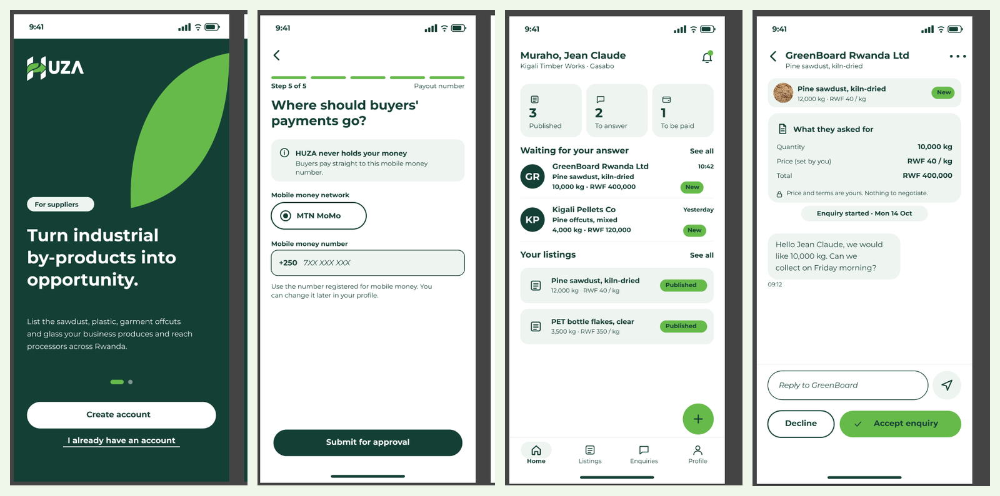
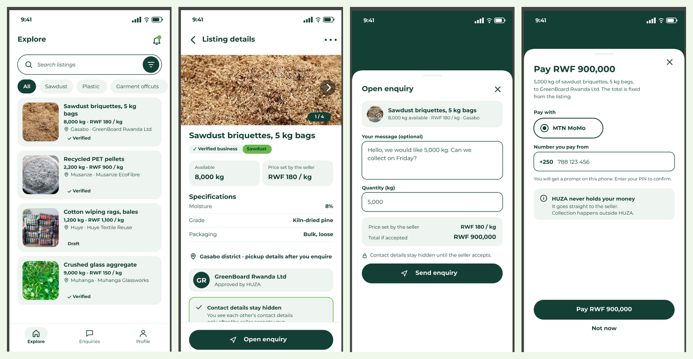
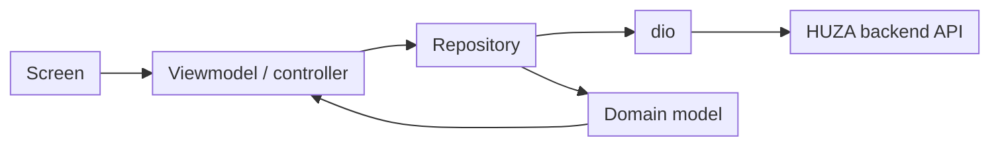

# Mobile app

The HUZA mobile app is a Flutter app for **suppliers and buyers**. Suppliers post by-products and buyers explore listings, send enquiries and pay with MTN MoMo.

| Item | Details |
|---|---|
| Repository | `athena-mobile` (Flutter project in `huza/`) |
| App name | `huza` |
| Stack | Flutter, Dart (SDK ^3.13.5) |
| State | provider |
| Networking | dio |
| Talks to | The HUZA backend API (FastAPI) |

## Preview

**Supplier**



**Buyer**



## Local setup

Requirements: Flutter SDK matching `pubspec.yaml`, Android Studio or Xcode, and an emulator or a phone.

```bash
git clone <athena-mobile repository URL>
cd athena-mobile/huza
flutter pub get
flutter doctor
flutter run
```

### Commands

| Command | What it does |
|---|---|
| `flutter pub get` | Install dependencies |
| `flutter run` | Run on the connected device or emulator |
| `flutter analyze` | Static analysis with `flutter_lints` |
| `flutter test` | Run the tests |
| `dart format .` | Format the code |
| `flutter build apk` | Build an Android package |

On the Android emulator, the computer's localhost is `10.0.2.2`, not `127.0.0.1`.

## How the app works

1. `lib/main.dart` starts the app and applies the theme from `lib/core/theme/`.
2. `lib/app/app_shell.dart` is the main layout with bottom navigation.
3. Each feature lives in `lib/features/<feature>/`.
4. Screens in `presentation/` show the UI. They read state from a **viewmodel** or controller through `provider`.
5. The viewmodel calls a **repository** in `data/`. The repository uses `dio` to call the API.
6. Repositories turn API responses into **domain** models used by the screens.



## Repository structure

| Path | Purpose |
|---|---|
| `lib/main.dart` | App entry |
| `lib/app/app_shell.dart` | App layout and navigation |
| `lib/core/theme/` | Colours, text styles and theme |
| `lib/core/widgets/` | Shared widgets such as the listing card |
| `lib/core/models/` | Shared models such as the listing model |
| `lib/core/features/` | Shared screens: explore and listing details |
| `lib/features/dashboard/` | Dashboard (data, domain, viewmodels, presentation) |
| `lib/features/processor_explore/` | Explore listings for processors |
| `lib/features/payment/` | Buyer payment flow, seller payment screens, controller, repository |
| `lib/features/registration/` | Sign up (domain, presentation) |
| `lib/features/profile/` | Profile (data, domain, presentation) |
| `lib/features/notifications/` | Notifications (data, domain, presentation) |
| `lib/features/price_guide/` | Price guide (data, domain, presentation) |
| `assets/` | Images, sample data and Montserrat fonts |
| `test/` | Tests |
| `android/`, `ios/`, `web/`, `linux/`, `macos/`, `windows/` | Platform folders |
| `analysis_options.yaml` | Lint rules |

## Dependencies

| Package | Why we use it |
|---|---|
| flutter | UI framework |
| provider | State management |
| dio | HTTP calls to the API |
| google_fonts | Fonts |
| image_picker | Photos for listings and profiles |
| cupertino_icons | iOS style icons |
| flutter_lints | Lint rules |
| flutter_test | Tests |

The app uses the Montserrat font from `assets/fonts/`.

## Coding standards

- One folder per feature, with `data`, `domain`, `presentation` and `viewmodels` where they are needed.
- Screens contain UI only. No API calls inside widgets.
- Repositories own all `dio` calls.
- Use colours and text styles from `lib/core/theme/`. Do not hard-code them.
- Reuse widgets from `lib/core/widgets/` before making new ones.
- File names are `snake_case`. Classes are `PascalCase`.
- Run `flutter analyze` and `dart format .` before every commit.

## How to add or change a feature

1. Create `lib/features/<feature>/` with `data`, `domain`, `presentation` and `viewmodels`.
2. Define the domain model, then the repository that calls the API.
3. Add a viewmodel that holds loading, data and error state.
4. Build the screen and connect it with `provider`.
5. Add the screen to `app_shell.dart` if it needs a menu entry.
6. Write tests in `test/`.
7. Run `flutter analyze` and `flutter test`, then open a pull request.

## Security

- Never put secrets or API keys in the app. It can be unpacked.
- Store the access token safely and send it only to the HUZA API.
- Do not print tokens or personal data in logs.
- Phone numbers for MTN MoMo are sent to the backend only. The app never talks to MTN directly.
- Contact details are shown only after an enquiry is accepted. The backend enforces this.

## Testing

```bash
flutter test
```

Test viewmodels and repositories first. Use widget tests for screens with several states: loading, data, empty and error.

## Deployment

- Android: `flutter build apk` or `flutter build appbundle`, then upload to Google Play.
- iOS: `flutter build ipa`, then upload through App Store Connect.
- The API URL must point to the hosted backend for release builds. See [Backend deployment](../backend/deployment.md).

## Troubleshooting

| Problem | Fix |
|---|---|
| `flutter pub get` fails | Check the Flutter version against `pubspec.yaml` and run `flutter doctor` |
| App cannot reach the API on the emulator | Use `10.0.2.2` instead of `127.0.0.1` |
| Fonts look wrong | Check the font files exist in `assets/fonts/` and are listed in `pubspec.yaml` |
| Image picker does nothing on a phone | Check camera and photo permissions in the Android and iOS settings |
| Strange build errors | Run `flutter clean` then `flutter pub get` |

## Definition of done

- [ ] Works on a small and a large phone
- [ ] Loading, empty and error states handled
- [ ] Tests written and passing
- [ ] `flutter analyze` is clean and the code is formatted
- [ ] No secrets or tokens in code or logs
- [ ] Pull request reviewed and approved

## Summary

The mobile app is a Flutter app organised by feature. Screens talk to viewmodels through provider, viewmodels use repositories, and repositories call the API with dio.
