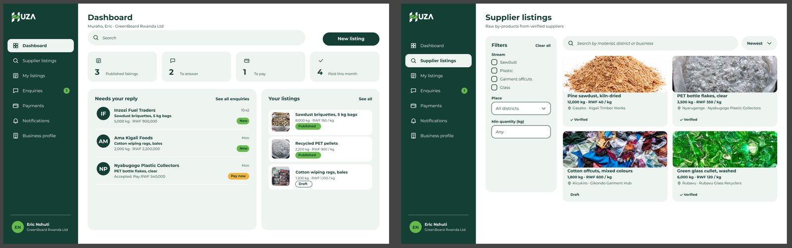
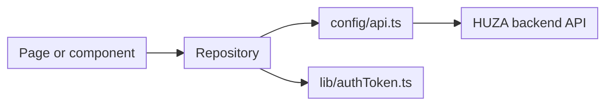

# Web app (PWA)

The HUZA web app is a React web app for **processors**. It lets a processor browse raw by-products from suppliers, open enquiries, manage their own listings and follow notifications.

| Item | Details |
|---|---|
| Repository | `athena-frontend` |
| Package name | `huza-processor-pwa` |
| Stack | React 19, Vite 8, TypeScript, Tailwind CSS 4 |
| Dev port | 3000 |
| Talks to | The HUZA backend API (FastAPI) |

## Preview



## Local setup

Requirements: Node.js (current LTS) and npm. The backend should be running if you want real data.

```bash
git clone <athena-frontend repository URL>
cd athena-frontend
npm ci
cp .env.example .env
npm run dev
```

Open http://localhost:3000.

In `.env`, remove the `#` in front of `VITE_API_URL` and set it to the backend address. The app needs this value to start. Do not commit `.env`. Only `.env.example` lives in git.

### Scripts

| Command | What it does |
|---|---|
| `npm run dev` | Start the dev server on port 3000 |
| `npm run build` | Type check (`tsc -b`) and build to `dist/` |
| `npm run lint` | Run oxlint |
| `npm run format` | Format with Prettier |
| `npm run format:check` | Check formatting without changing files |
| `npm test` | Run the Vitest tests once |

## How the app works

1. `src/main.tsx` mounts `App.tsx`, which sets up React Router.
2. `AuthFlow` handles sign in and sign up. After sign in, the token is stored through `src/lib/authToken.ts`.
3. `AppShell` is the layout: sidebar, header and the page content.
4. Each feature has its own pages and a **repository** file. The repository is the only place that calls the API.
5. `src/config/api.ts` holds the API base URL, so no page hard-codes a URL.
6. Forms use React Hook Form with validation in a `validation.ts` file.



## Repository structure

| Path | Purpose |
|---|---|
| `src/main.tsx`, `src/App.tsx` | App entry and routes |
| `src/config/api.ts` | API base URL |
| `src/lib/` | Small helpers: `authToken.ts` (token storage), `cn.ts` (class names) |
| `src/components/` | Shared UI: `AppShell`, `Dialog`, `Form` |
| `src/features/auth/` | Sign in, sign up, validation, hooks, API calls |
| `src/features/profile/` | Business profile, photo upload, account dialogs |
| `src/features/dashboard/` | Dashboard page, components, viewmodels, API, types |
| `src/features/supplier-listings/` | Browse listings, listing details, open an enquiry |
| `src/features/notifications/` | Notifications page and repository |
| `src/features/businesses/` | Shared business types |
| `src/assets/sample/` | Sample images used in the UI |
| `src/setupTests.ts` | Test setup |
| `vite.config.ts` | Vite, React, Tailwind and Vitest config |
| `docs/api/` | API notes for the app |
| `workflow/ci.yml` | CI workflow |

## Dependencies

| Package | Why we use it |
|---|---|
| React 19 | UI |
| Vite 8 | Dev server and build |
| TypeScript | Type safety |
| Tailwind CSS 4 | Styling |
| React Router 7 | Pages and navigation |
| React Hook Form | Forms and validation |
| Radix UI Dialog | Accessible dialogs |
| lucide-react | Icons |
| Vitest and Testing Library | Tests |
| oxlint and Prettier | Linting and formatting |

## Coding standards

- One folder per feature under `src/features/`.
- Pages end with `Page`, for example `SupplierListingsPage.tsx`.
- Only repositories (or the feature `api` folder) call the backend. Pages and components never use `fetch` directly.
- Types live next to the feature in `types.ts` or a `types/` folder.
- Shared UI goes in `src/components/`. Use it before creating a new one.
- Style with Tailwind classes. Use the HUZA colours from the style guide.
- Keep tests in the feature's `__tests__` folder.
- Run `npm run lint` and `npm run format:check` before every commit.

## How to add or change a feature

1. Create `src/features/<feature>/` with the page, repository, types and a `__tests__` folder.
2. Write the repository functions that call the API through `src/config/api.ts`.
3. Build the page and use shared components from `src/components/`.
4. Add the route in `src/App.tsx` and a link in `AppShell` if it belongs in the menu.
5. Write tests for the repository and the page.
6. Run `npm run lint`, `npm run format:check`, `npm test` and `npm run build`.
7. Open a pull request using the team rules.

## Security

- The access token is handled only in `src/lib/authToken.ts`. Do not read or write it anywhere else.
- Never put secrets in the app. Anything in `VITE_` variables ends up in the browser bundle.
- Do not log tokens or personal data.
- Contact details of a business are shown only after an enquiry is accepted. The backend enforces this and the UI must not work around it.
- Keep the API on HTTPS in production.

## Testing

Tests use Vitest with the `jsdom` environment and Testing Library. `src/setupTests.ts` runs before every test file.

```bash
npm test
```

Write a test for each repository function and for each page's main states: loading, data, empty and error.

## Deployment

```bash
npm run build
```

This runs `tsc -b` and `vite build` and writes a static site to `dist/`. Host the contents of `dist/` on any static host over HTTPS. The API URL must be set at build time. See [Backend deployment](../backend/deployment.md).

## Troubleshooting

| Problem | Fix |
|---|---|
| The app shows a blank page or says the API is not configured | Set `VITE_API_URL` in `.env` and restart the dev server |
| API calls fail in the browser | Check that `VITE_API_URL` points to a running backend |
| Signed out after refresh | Check the token helper in `src/lib/authToken.ts` and that the token has not expired |
| `npm ci` fails | Use the Node version the team uses and delete `node_modules` first |

## Definition of done

- [ ] Works on a phone-sized screen and a laptop
- [ ] Loading, empty and error states handled
- [ ] Tests written and passing
- [ ] `npm run lint`, `npm run format:check` and `npm run build` pass
- [ ] No secrets or tokens in code or logs
- [ ] Pull request reviewed and approved

## Summary

The PWA is a React and Vite app organised by feature. Pages talk to the backend only through repositories and the build produces a static site.
