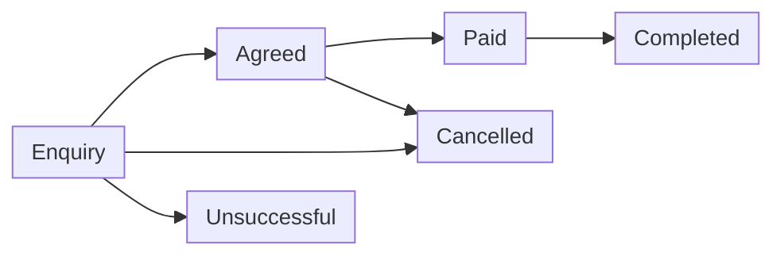

# Overview

## What HUZA is

HUZA is a marketplace for industrial by-products. Businesses that have leftover materials list them. Businesses that can use those materials find them, agree on an exchange and pay in the app.

HUZA staff review every new business before it can trade and they watch the marketplace through the admin dashboard.

## Who uses HUZA

| Role | What they do |
| --- | --- |
| Supplier | Lists raw by-products. A supplier can be a producer, a collector or a dealer. |
| Processor | Buys raw by-products, turns them into new products and lists those finished products. |
| Buyer | Searches for and buys finished products. |
| Staff | Approves businesses and watches the marketplace. |

## The four streams

  Sawdust
  Plastic
  Garment offcuts
  Glass

## How an exchange moves

| Status | Meaning |
| --- | --- |
| Enquiry | Someone has asked about a listing. |
| Agreed | The seller accepted and both sides agreed on the terms. |
| Paid | The buyer has paid in the app with M-Pesa. |
| Completed | The exchange is finished. |
| Cancelled | Someone stopped the exchange. |
| Unsuccessful | The exchange did not happen. A reason is recorded. |

When an exchange is cancelled or unsuccessful, HUZA records one reason: no partner found, quality, price, transport, quantity, trust, payment, declined or other. Staff use these reasons to see why exchanges fail.

## What HUZA keeps simple on purpose

- Collection and delivery are arranged between the two businesses, outside the app.
- Contact details are shown only after the seller accepts an enquiry.
- Every new business is approved by staff before it can trade.
- There is one clear status for every exchange.

## The apps

| App | Used by | Purpose |
| --- | --- | --- |
| [Mobile app](frontend/mobile-app.md) | Suppliers and buyers | Suppliers list raw materials. Buyers search for finished products. Both send enquiries. |
| [Web app (PWA)](frontend/pwa.md) | Processors | Search raw materials, list finished products and send enquiries. |
| [Admin dashboard](frontend/admin-dashboard.md) | Staff | Approve businesses and watch the marketplace. |
